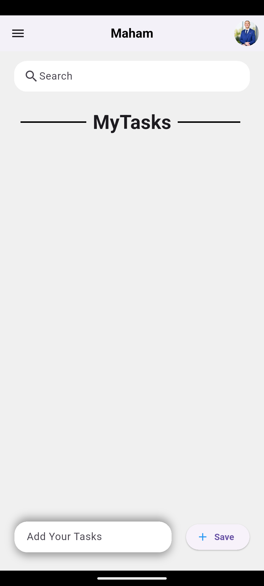
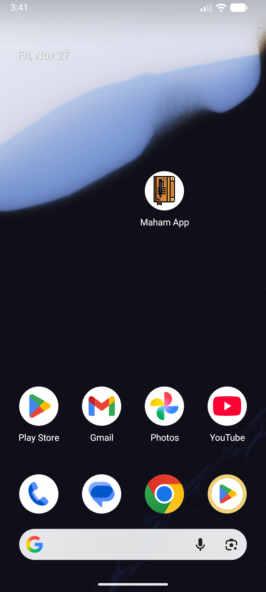
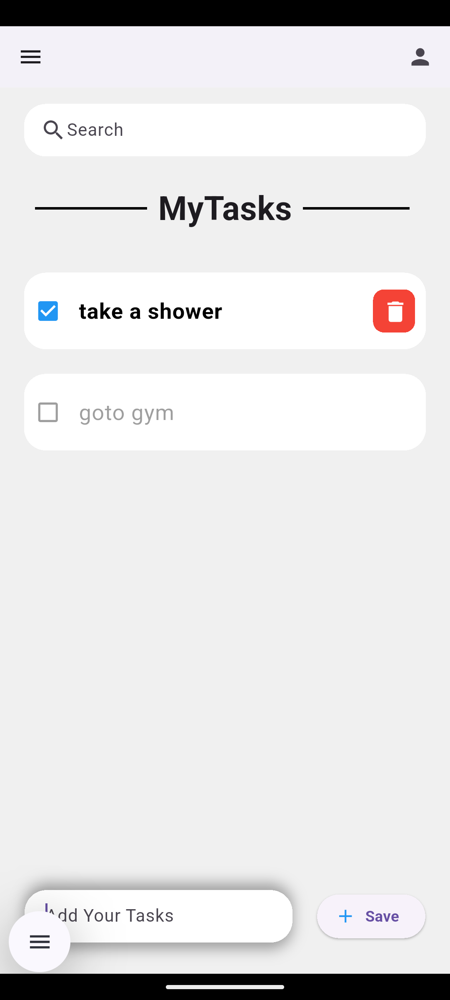
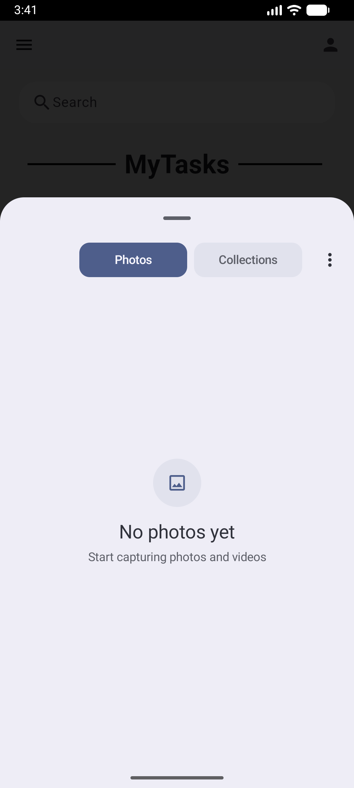
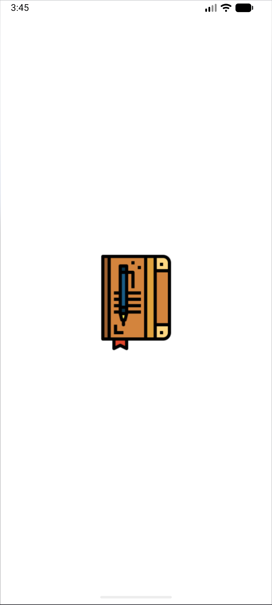

# ✅ Todo App — Maham

A simple and clean **Todo mobile application** built with **Flutter**, designed to help users manage their daily tasks efficiently with persistent local storage and smooth state management using **Cubit**.

---

## 📱 Screenshots

    
---

## ✨ Features

- ➕ **Add Tasks** — Create new tasks quickly
- ✏️ **Edit Tasks** — Update existing tasks anytime
- 🗑️ **Delete Tasks** — Remove completed or unwanted tasks
- ✅ **Mark as Done** — Toggle task completion status
- 🔍 **Search Tasks** — Filter tasks by keyword in real time
- 🖼️ **Custom Profile Picture** — Pick a photo from gallery, saved permanently on device
- 💾 **Persistent Storage** — Tasks saved locally using **SharedPreferences** and remain after app restart
- 📐 **Responsive UI** — Adapts to all screen sizes using flutter_screenutil
- 🎯 **Clean Architecture** — Organized with features/cubit/model/presentation structure

---

## 🛠️ Tech Stack

| Technology | Usage |
|---|---|
| **Flutter** | UI Framework |
| **Dart** | Programming Language |
| **Cubit (flutter_bloc)** | State Management |
| **SharedPreferences** | Local Data Persistence |
| **image_picker** | Pick Profile Image from Gallery |
| **path_provider** | Save Image to App Directory |
| **flutter_screenutil** | Responsive UI |

---

## 📂 Project Structure

```
lib/
├── core/
│   └── constants/
│       └── text_style.dart       # App text styles
├── features/
│   └── home/
│       ├── cubit/
│       │   ├── task_cubit.dart   # Task business logic
│       │   └── task_state.dart   # Cubit states
│       ├── model/
│       │   └── task_model.dart   # Task data model
│       └── presentation/
│           ├── page/             # Home screen
│           └── widgets/          # Reusable UI components
└── main.dart
```

---

## 🚀 Getting Started

### Prerequisites
- Flutter SDK >= 3.0.0
- Dart >= 3.0.0

### Installation

```bash
# 1. Clone the repository
git clone https://github.com/A7-samie/todo_maham.git

# 2. Navigate to project directory
cd todo_maham

# 3. Install dependencies
flutter pub get

# 4. Run the app
flutter run
```

---

## 📦 Dependencies

```yaml
dependencies:
  flutter_screenutil: ^5.9.3
  flutter_bloc: ^8.1.6
  shared_preferences: ^2.3.2
  image_picker: ^1.2.4
  path_provider: ^2.1.6
  path: ^1.9.1
```

---

## 💡 How It Works

Tasks are stored locally on the device using **SharedPreferences**. The profile picture is copied into the app's documents directory using **path_provider**, ensuring it persists even if the original photo is deleted from the gallery. The app follows a clean feature-based architecture with **Cubit** handling all business logic separately from the UI, making the code easy to maintain and scale.

---

## 👨‍💻 Author

**A7-samie**  
GitHub: [@A7-samie](https://github.com/A7-samie)

---

## 📄 License

This project is open source and available under the [MIT License](LICENSE).